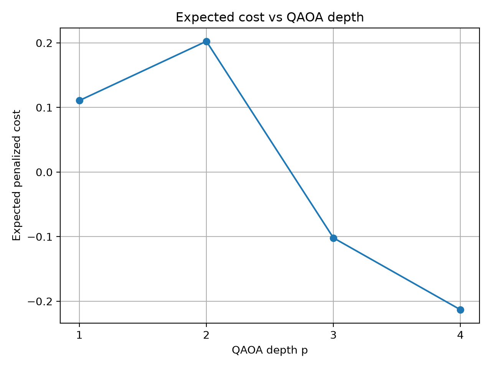
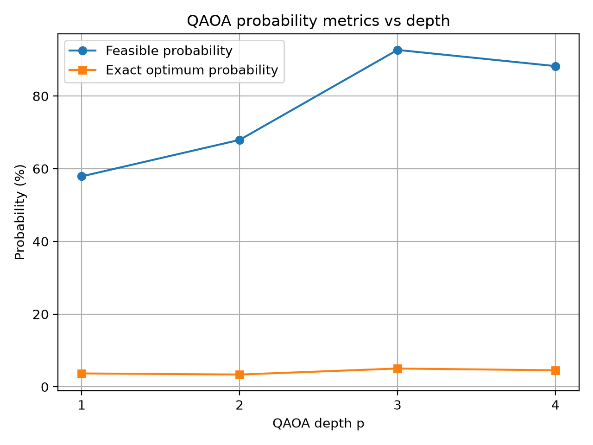
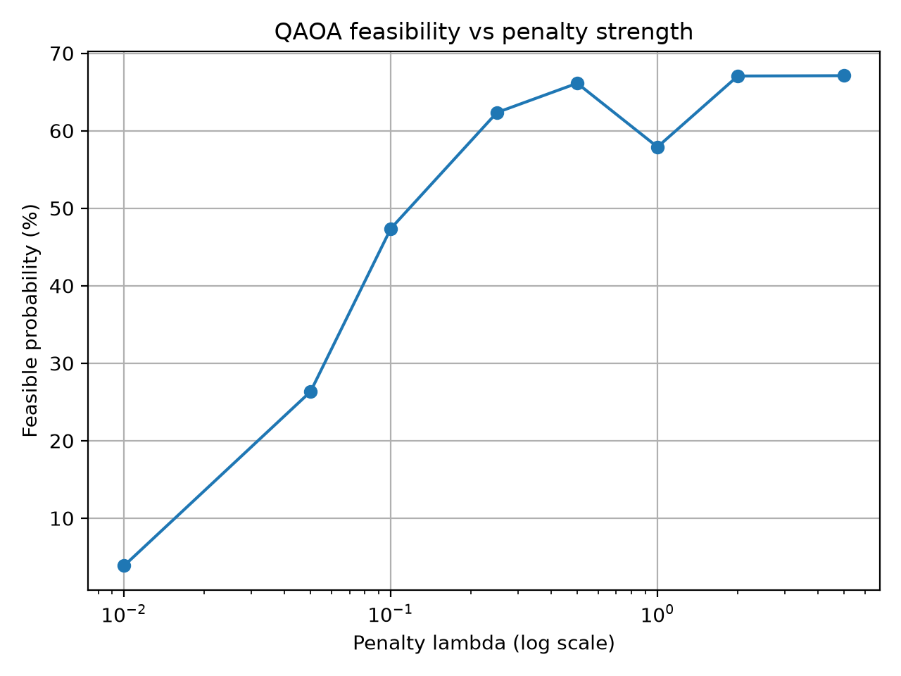
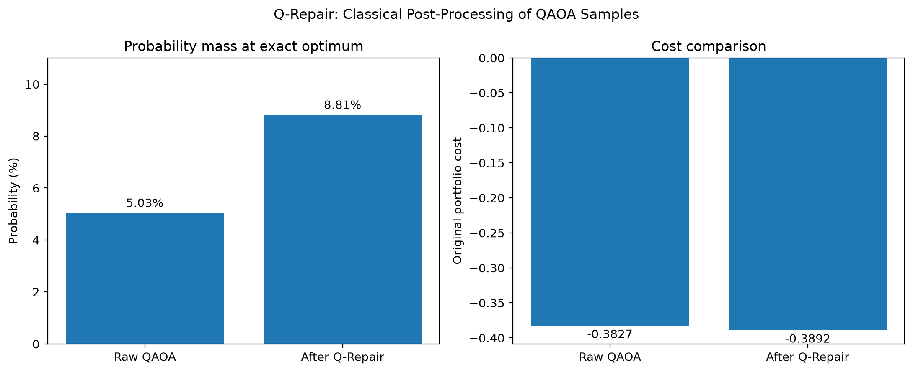

# Quantum Portfolio Optimization Using QAOA

**Event:** Qiskit Fall Fest 2026  
**Track:** Track 2 — Quantum Optimization  
**Project:** Quantum Portfolio Optimization with QAOA and Q-Repair  
**Language:** Python

---

## 1. Overview

This project investigates the **Quantum Approximate Optimization Algorithm (QAOA)** for fixed-cardinality portfolio optimization.

The objective is to select a specified number of stocks while balancing expected returns against portfolio risk. The project combines classical exhaustive search, statevector-based QAOA-style optimization, circuit-depth experiments, penalty-parameter analysis, initialization sensitivity, and a classical post-processing technique called **Q-Repair**.

The implementation evaluates two problem sizes:

- **Six-stock instance:** QAOA-style statevector experiments and Q-Repair analysis.
- **Twelve-stock instance:** Classical exhaustive search and greedy baselines.

The project focuses on reproducible experiments, quantitative evaluation, and transparent reporting of limitations. It does not claim quantum advantage.

## 2. Problem Statement

Given an expected-return vector and a covariance matrix, select exactly \(K\) stocks from \(n\) available stocks.


Each stock is represented by a binary decision variable:

$$
x_i \in \{0,1\}
$$

where $x_i=1$ indicates that stock $i$ is selected.


The optimization objective is:

$$
C(x) = q\,x^T\Sigma x - \mu^T x + \lambda\left(\sum_{i=1}^{n}x_i-K\right)^2
$$

Where:

- $x$: Binary portfolio-selection vector
- $\mu$: Expected-return vector
- $\Sigma$: Covariance matrix
- $q$: Risk-weight parameter
- $K$: Required number of selected stocks
- $\lambda$: Penalty parameter for violating the cardinality constraint

The objective is minimized. The covariance term represents portfolio risk, the return term rewards higher expected returns, and the penalty discourages portfolios that do not contain exactly \(K\) stocks.

## 3. Project Highlights

- Classical brute-force benchmark for the six-stock problem
- QAOA-style cost-phase and transverse-field mixer simulation
- Circuit-depth comparison for \(p=1,2,3,4\)
- Penalty-parameter sweep across eight values
- Multiple optimizer initializations and sensitivity analysis
- Q-Repair for mapping infeasible candidates to feasible portfolios
- Twelve-stock classical baseline over all 924 feasible portfolios
- Reproducible numerical results and visualization artifacts
- Jupyter notebook and eight-page PDF presentation

## 4. Six-Stock Beginner Track

The six-stock experiment uses a deterministic synthetic dataset generated with random seed `2026`.

| Parameter | Value |
|---|---:|
| Number of stocks | 6 |
| Required portfolio size | 3 |
| Risk-weight parameter | 0.5 |
| Total binary strings | 64 |
| Feasible portfolios | 20 |
| QAOA depths tested | 1, 2, 3, 4 |

### Classical brute-force baseline

All 20 portfolios satisfying the exact-three-stock constraint were evaluated.

The best portfolio is:

- **Selected stocks:** 2, 3, 6
- **Binary representation:** `011001`
- **Objective cost:** approximately `-0.503015`

This solution is the exact optimum for the tested six-stock instance and provides a reference point for evaluating the approximate optimization experiments.

## 5. QAOA Approach

The six-stock implementation uses a statevector representation with QAOA-style cost-phase and transverse-field mixer layers.

The cost phase applies the objective-dependent phase to computational-basis states, while the mixer applies RX rotations to individual qubits. The parameter \(p\) represents the number of alternating cost and mixer layers.

Classical optimization is used to search for suitable QAOA parameters.

**Implementation note:** The reported depth and penalty experiments use direct statevector operations. They should not be described as GPU-accelerated or as completed Qiskit Aer circuit simulations.

### Depth-sweep results

| Depth \(p\) | Expected cost | Feasible probability | Exact-optimum probability |
|---:|---:|---:|---:|
| 1 | 0.110713 | 57.90% | 3.68% |
| 2 | 0.202474 | 67.94% | 3.38% |
| 3 | -0.101954 | 92.69% | 5.03% |
| 4 | -0.213192 | 88.23% | 4.55% |

The \(p=3\) run achieved the highest feasible probability in the reported sweep, while \(p=4\) achieved the lowest expected cost.

These metrics measure different aspects of performance. The results are not strictly monotonic with increasing depth.

The classical brute-force optimum remains the reference solution; the approximate QAOA runs are not claimed to outperform it.

**Optimization limitation:** The \(p=2,3,4\) runs reached the configured maximum of 100 objective evaluations. Their reported parameters are not guaranteed to be globally optimal.

### Depth-sweep visualizations





## 6. Penalty-Parameter Experiment

The penalty parameter \(\lambda\) controls how strongly the objective discourages portfolios that do not contain exactly three stocks.

The tested values are:

`0.01, 0.05, 0.1, 0.25, 0.5, 1, 2, 5`

Each value was tested using a depth-one QAOA configuration with two optimizer initializations and a maximum of 80 iterations per initialization.

### Observations

- At \(\lambda=0.01\), the feasible probability was approximately **3.88%**.
- At \(\lambda=1\), the exact-optimum probability was approximately **3.68%**, the highest observed in this sweep.
- At \(\lambda=5\), the feasible probability was approximately **67.10%**, the highest observed in this sweep.
- Performance was non-monotonic: increasing the penalty did not guarantee better results under the finite optimization budget.

The best penalty value therefore depends on the metric being optimized. Feasibility probability and exact-optimum probability are not interchangeable.



## 7. Intermediate Track: Twelve-Stock Classical Baseline

A separate experiment considers selecting exactly six stocks from twelve.

The number of feasible portfolios is:

$$
\binom{12}{6}=924
$$

All 924 feasible portfolios were enumerated.

The best solution found selected:

- **Zero-indexed stocks:** `(1, 5, 6, 8, 10, 11)`
- **One-indexed stocks:** `2, 6, 7, 9, 11, 12`
- **Objective cost:** approximately `-1.066392`

The expected-return greedy baseline and marginal-cost greedy baseline both found the same portfolio on this particular synthetic instance. This agreement is specific to the generated data and does not establish that greedy methods generally find optimal portfolios.

**Scope limitation:** The twelve-stock result is a classical baseline. A completed twelve-stock QAOA result is not claimed.

## 8. Novel Contribution: Q-Repair

### Motivation

Approximate optimization algorithms can assign probability to bitstrings that violate portfolio constraints. Q-Repair investigates whether classical post-processing can map these candidates to feasible portfolios while preserving useful information from the original distribution.

### Methodology

Q-Repair operates on each six-bit portfolio candidate:

1. Count the number of selected stocks.
2. Preserve the candidate if exactly three stocks are selected.
3. Otherwise, identify feasible portfolios at the minimum Hamming distance from the original candidate.
4. Break ties by selecting the feasible portfolio with the lowest original risk-return objective.
5. Aggregate the input probability mass according to the repaired portfolio.

The repair rule uses the original portfolio objective, excluding the cardinality penalty, to compare feasible candidates.

### Experimental results

| Metric | Raw QAOA | After Q-Repair |
|---|---:|---:|
| Probability mass at exact optimum | 5.03% | 8.81% |
| Expected original portfolio cost | -0.382748* | -0.389191 |
| Exact optimum | Stocks 2, 3, 6 | Stocks 2, 3, 6 |

\*The raw expected cost is conditional on obtaining a feasible portfolio, whereas the repaired expected cost is computed over the complete input distribution after every candidate has been repaired. These are different evaluation populations and should not be interpreted as directly equivalent sampling metrics.

The probability mass mapped to the exact optimum increased by approximately **3.78 percentage points**, or **1.75 times** the raw optimum probability.

This is a post-processing result, not evidence of quantum advantage.



### Initialization sensitivity

Eight deterministic starting points were evaluated with COBYLA, using a maximum of 100 objective evaluations per run.

- Best observed penalized objective: `-0.101954`
- Worst observed penalized objective: `0.522604`
- All eight runs reached the evaluation limit with `success=False`

These results indicate substantial sensitivity to initialization under the tested budget. They should be interpreted as preliminary rather than as evidence of successful optimizer convergence.

### Q-Repair limitations

- Q-Repair is classical post-processing.
- It uses the known objective function to rank feasible candidates.
- Results are based on a six-stock synthetic dataset and statevector simulation.
- Probability mass after repair is not the raw quantum measurement probability of the repaired portfolio.
- The optimizer did not report successful convergence within the configured evaluation budget.

## 9. Visualizations and Results

| File | Purpose |
|---|---|
| `plots/qaoa_probabilities.png` | Feasibility and exact-optimum probabilities across depths |
| `plots/qaoa_expected_cost.png` | Expected objective cost across depths |
| `plots/qaoa_penalty_sweep.png` | Effect of penalty strength on observed performance |
| `plots/q_repair_comparison.png` | Raw-versus-repaired portfolio comparison |

Numerical experiment outputs are stored under `results/`.

Key result files include:

- `results/qaoa_depth_sweep.csv`
- `results/qaoa_depth_sweep.npz`
- `results/qaoa_penalty_sweep.csv`
- `results/qaoa_initialization_stability.csv`
- `results/q_repair_results.csv`
- `results/q_repair_distribution.npz`

The NPZ files contain numerical arrays used by the experiments and plots.

## 10. Technology Stack

- **Python:** Experiment implementation
- **NumPy:** Numerical computation and statevector operations
- **SciPy:** Classical optimization
- **Matplotlib:** Visualization
- **Qiskit:** Quantum-computing framework installed in the project environment
- **Qiskit Aer:** Simulator package installed in the project environment
- **Jupyter Notebook:** Interactive experiment walkthrough
- **ReportLab:** PDF presentation generation

The reported QAOA-style depth and penalty experiments use direct statevector operations. Qiskit Aer is installed, but the reported results should not be described as completed Aer circuit simulations.

## 11. Repository Structure

```text
Qiskit-Fall-Fest/
├── README.md
├── .gitignore
├── presentation.pdf
├── notebooks/
│   └── quantum_portfolio_optimization.ipynb
├── src/
│   ├── portfolio_test.py
│   ├── qaoa_six_stock.py
│   ├── plot_results.py
│   ├── penalty_sweep.py
│   ├── q_repair.py
│   ├── plot_q_repair.py
│   ├── create_notebook.py
│   └── create_presentation.py
├── results/
│   ├── qaoa_depth_sweep.csv
│   ├── qaoa_depth_sweep.npz
│   ├── qaoa_penalty_sweep.csv
│   ├── qaoa_initialization_stability.csv
│   ├── q_repair_results.csv
│   └── q_repair_distribution.npz
└── plots/
    ├── qaoa_probabilities.png
    ├── qaoa_expected_cost.png
    ├── qaoa_penalty_sweep.png
    └── q_repair_comparison.png
```

## 12. Setup and Reproducibility

The project was developed on Windows using Python 3.13.7. The environment used Qiskit 2.5.2 and Qiskit Aer 0.17.2.

Exact package versions for the remaining dependencies may vary unless they are pinned in a dependency file.

### Create and activate the virtual environment

```powershell
cd E:\Qiskit-Fall-Fest

python -m venv .venv

.\.venv\Scripts\Activate.ps1
```

### Install dependencies

```powershell
python -m pip install numpy scipy matplotlib pandas qiskit qiskit-aer jupyter nbformat nbclient reportlab
```

### Run the experiments

```powershell
python src\portfolio_test.py
python src\qaoa_six_stock.py
python src\plot_results.py
python src\penalty_sweep.py
python src\q_repair.py
python src\plot_q_repair.py
```

These commands rerun the baseline checks, QAOA depth sweep, plots, penalty sweep, Q-Repair experiment, and comparison visualization.

**Note:** Re-running an experiment can overwrite its result files. Optimizer settings, initialization, and dependency versions may affect the numerical outputs.

### Notebook and presentation

The notebook is available at:

`notebooks/quantum_portfolio_optimization.ipynb`

The generated presentation is available at:

`presentation.pdf`

To regenerate them, use:

```powershell
python src\create_notebook.py
python src\create_presentation.py
```

The notebook and presentation should be checked after regeneration to confirm that their contents correspond to the current experiment outputs.

## 13. Limitations and Future Work

### Current limitations

1. The experiments use synthetic data rather than historical market data.
2. Six-stock QAOA-style results are approximate and use finite optimizer budgets.
3. Results may vary with initialization, optimizer settings, depth, and penalty strength.
4. The twelve-stock experiment establishes a classical baseline only.
5. Q-Repair is a classical post-processing heuristic and does not establish quantum advantage.
6. The reported statevector experiments are not presented as hardware execution or completed Aer circuit simulations.

### Future work

- Implement and validate gate-level Qiskit circuits.
- Compare suitable statevector and circuit-simulation backends.
- Investigate improved parameter initialization and optimization strategies.
- Evaluate the approach using historical financial data.
- Compare QAOA and Q-Repair against stronger classical baselines.
- Study constraint-preserving mixers and alternative penalty formulations.
- Explore larger instances while reporting computational cost and convergence honestly.

## 14. Conclusion

This project formulates fixed-cardinality portfolio selection as a binary optimization problem and investigates QAOA-style statevector optimization on a six-stock instance.

Classical brute-force enumeration provides an exact reference optimum. Depth and penalty sweeps illustrate how algorithm settings influence feasibility and solution quality. Q-Repair explores whether classical post-processing can improve the distribution of feasible candidates and probability mass assigned to the reference optimum.

A separate twelve-stock experiment provides a classical baseline without claiming a completed larger-scale QAOA experiment.

The findings are preliminary and instance-specific. They demonstrate an experimental workflow for quantum optimization, classical benchmarking, reproducibility, and critical evaluation rather than a demonstrated quantum advantage.

---

**Repository:** [qiskit-quantum-portfolio-optimization](https://github.com/Techz-Shikher/qiskit-quantum-portfolio-optimization)

**Project focus:** Quantum optimization, QAOA-style statevector simulation, portfolio constraints, classical benchmarking, and Q-Repair.